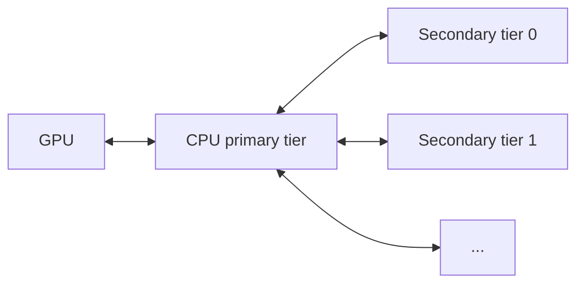

# KV Offloading Usage Guide

This guide covers configuration of the [`OffloadingConnector`](disagg_prefill.md), which extends the prefix cache by offloading completed KV blocks to slower but larger tiers (CPU host memory, plus optional secondary tiers) as they are produced. Hits in the offload tiers are promoted back to GPU on demand. Transfers between GPU and CPU use DMA (`cudaMemcpyAsync`) and run asynchronously alongside model computation, so offloading adds minimal CPU- and GPU-core overhead.

!!! note
    The `OffloadingConnector` currently supports CUDA, ROCm, and XPU only.

## Overview

Two specs are available, selected by the `spec_name` key in `kv_connector_extra_config`:

- `CPUOffloadingSpec` (default): single CPU tier. Completed GPU blocks are copied into pinned host memory.
- `TieringOffloadingSpec`: multi-tier. A CPU primary tier plus one or more secondary tiers.

Only the CPU primary tier has direct GPU access. Secondary tiers cannot read from or write to GPU memory; all GPU↔secondary transfers are staged through the CPU primary tier.



## Per-request load control

Individual requests can cap how many tokens are loaded from offloaded storage
by setting `max_load_tokens` in `kv_transfer_params`. The cap applies to tokens
beyond those already available in the GPU prefix cache. Set it to `0` to
disable external loading for the request:

```json
{
  "kv_transfer_params": {
    "max_load_tokens": 0
  }
}
```

GPU prefix-cache reuse remains enabled, and tokens beyond the aligned load cap
are recomputed. Omitting the field leaves loading uncapped. The value must be a
non-negative integer; invalid values are ignored. Positive caps are rounded
down to a boundary supported by the configured KV cache groups. Offloading
remains enabled unless it is controlled separately with `max_offload_tokens`.

!!! warning
    `max_load_tokens` is experimental and subject to change.

`kv_load_tiers` continues to select secondary tiers. CPU is always included:
it can satisfy a resident hit directly and is the required staging tier for
secondary-to-GPU loads. Consequently, an empty tier list allows CPU hits but
does not query any secondary tier.

## Terminology: Chunks

The unit of operation is a **chunk** — a fixed-size piece of KV data covering a group of tokens. By default, a chunk maps to a single accelerator block. A configurable `blocks_per_chunk` parameter allows larger chunks, yielding larger I/Os to the host and secondary tiers.

## Single-Tier Setup (CPU Only)

```bash
vllm serve <model> \
  --kv-transfer-config '{
    "kv_connector": "OffloadingConnector",
    "kv_role": "kv_both",
    "kv_connector_extra_config": {
      "block_size": 64,
      "cpu_bytes_to_use": 1000000000
    }
  }'
```

## Multi-Tier Setup

Set `spec_name` to `"TieringOffloadingSpec"` and supply a `secondary_tiers` list. Each entry is a dict with a required `type` key plus tier-specific fields (and an optional `module_path` for out-of-tree tiers). The list is ordered: tier 0 is consulted before tier 1, and so on. See [Secondary Tiers](#secondary-tiers) for tier-specific keys.

```bash
vllm serve <model> \
  --kv-transfer-config '{
    "kv_connector": "OffloadingConnector",
    "kv_role": "kv_both",
    "kv_connector_extra_config": {
      "spec_name": "TieringOffloadingSpec",
      "cpu_bytes_to_use": 10737418240,
      "block_size": 16,
      "eviction_policy": "lru",
      "secondary_tiers": [
        {
          "type": "fs",
          "root_dir": "/mnt/kv_cache",
          "n_read_threads": 32,
          "n_write_threads": 16
        }
      ]
    }
  }'
```

Secondary tiers are not supported yet on engines whose workers span several nodes; such an engine fails at startup.

## Rust Cache Service

To place cache ownership in a separate process, use
`spec_name: "RustServiceOffloadingSpec"` with `OffloadingConnector`.
The Rust service owns DRAM mappings, reservations, lookup leases, and eviction;
vLLM workers map its shared-memory descriptors and execute GPU copies.
This differs from `offload_region: "mmap"`, which allocates memory inside workers.

Choose this backend when one DRAM cache on the node should outlive a worker
restart within one engine lifetime, with eviction and lease bookkeeping outside
the engine process. It replaces the in-process CPU tier of `OffloadingConnector`
(`offload_region: "shared"`, `"mmap"`, or `"hmm"`), not LMCache: it has no
multi-node or disaggregated role, serves no remote peer, keeps no secondary tier,
does not persist across engine sessions, and is single-node tensor-parallel only,
so it is not a drop-in for `LMCacheConnectorV1`/`LMCacheMPConnector` in a
disaggregated prefill/decode or multi-tier deployment.

See the [Rust cache service guide](../../rust/src/kv-cache-service/README.md)
for startup commands, DeepSeek-V4.1-Flash configuration, supported scope,
CPU/GPU validation commands, and hash reporting details. The service stops on
`SIGTERM`/`SIGINT` and removes its socket; a start reclaims a socket left by a
killed service and refuses a path another process still serves, so a supervisor
can restart it without manual cleanup.

The spec rejects, before it connects, any `kv_connector_extra_config` key it
cannot serve, naming the key: `cache_policy_module_path`, `max_tracker_size`, and
`secondary_tiers` say what to use instead, and any other unknown key is reported
as unsupported. It honours `service_socket`, `service_timeout`,
`service_connect_timeout`, `cpu_bytes_to_use`, `blocks_per_chunk`/`block_size`,
`spec_name`, `offload_region: "shared"`, `eviction_policy: "lru"`,
`store_threshold` below 2, `pin_host_memory`, and the generic `offload_prompt_only`,
`self_describing_kv_events`, and `sync_load_budget_bytes` settings. A
`canonical_layout` request is refused. `service_timeout` (default 5 s) bounds each
control RPC, and `service_connect_timeout` (default 5 s) bounds connecting,
including the bounded retry that lets an engine start race the service.

`pin_host_memory` defaults to `true` and decides whether kernel-managed offload
can run at all: registering the region with the accelerator page-locks it, and
the kernel excludes locked ranges from reclaim, so `MADV_PAGEOUT` answers
`EINVAL` and rswap never stores those pages. Set it to `false` when the cache
must stay migratable for rswap (the copies become pageable, which is slower but
correct).

In plain terms, the unsupported combinations are:

- pipeline parallelism, prefill context parallelism, and decode context
  parallelism (tensor parallelism only, and the offload workers are exactly the TP
  group);
- `canonical_layout`, because each rank stores its own copy;
- `TieringOffloadingSpec` and `secondary_tiers`, which stay in-process;
- `eviction_policy` other than `lru`, so no `arc` policy and no
  `cache_policy_module_path`;
- `store_threshold` of 2 or more, and `max_tracker_size`, because the service
  stores every offered chunk instead of counting reuse;
- `offload_region` other than `shared`, because the service owns the mapping;
- a second engine sharing one `engine_id`, since the namespace belongs to that
  engine's scheduler.

At startup the spec asks the service's `info` op for its `--capacity-bytes` and
caps `num_chunks` to what that budget holds: a `cpu_bytes_to_use` larger than the
service can serve is trimmed with a warning instead of failing `open` later, and
a `cpu_bytes_to_use`, or a service budget, too small for one row is rejected with
the minimum to reserve. The realized geometry (`namespace`, `worker_bytes`,
`row_bytes`, `num_chunks`, `bytes`, `world_size`) is logged once at INFO, so the
engine log and `vllm:kv_offload_config_info` agree with what the service
allocated.

The arithmetic behind `cpu_bytes_to_use` is in
[Sizing](../../rust/src/kv-cache-service/README.md#sizing): one chunk holds
`blocks_per_chunk x worker_kv_bytes_per_block` bytes per rank, a row holds every
rank's slice of one chunk rounded up to the host page size, and
`num_chunks = cpu_bytes_to_use // row_bytes`. The service's `--capacity-bytes`
must cover every engine's reservation plus one restarting engine's. Because the
cap compares against the whole budget and not against what other namespaces
already hold, a second engine can still be refused by `open` with `cache exceeds
service capacity`, which fails that engine's startup.

Each rank pins its own slice of every chunk rather than the whole multi-rank
region, so host-pinned memory stays `num_chunks x worker_bytes` per worker
instead of `world_size` times that. Registration falls back to whole-region
registration when that saves less than 3 MiB per row, and unregistration logs a
warning instead of raising during worker shutdown.

A `store` reservation belongs to the request that made it, so only that request's
`commit` publishes it. A reservation that is still pending after
`--pending-timeout-secs` (default 60; 0 disables it) is reclaimed and logged, so a
request that dies between `store` and `complete_store` cannot leave a key that the
scheduler keeps retrying as a hit that never becomes readable. A `commit` that
reaches a reclaimed reservation is refused rather than fatal: the connector logs
one warning and treats that store as one that did not publish. A `reset`, which is
what `/reset_prefix_cache` reaches, happens in two phases: the connector releases
its leases, keeps stepping while workers report the transfers the reset flushed,
and only then sends the forced reset that recycles the slots. The service's
`stats` op reports the namespace counters (`hits`, `misses`, `pending_hits`,
`evictions`, `stores`, `commits`, `aborted`, `failed_commits`, `reclaimed`, and the
requests holding leases) that make such a leak visible, plus how many entries the
kernel still holds in DRAM (`resident`) and how many it has moved out (`remote`).

A service that stops answering, or that dropped the engine's namespace, does not
abort the scheduler step: the connector logs one error, reports every later lookup
as a miss, and stops reserving, until the engine is restarted. A lost connection is
the exception it can absorb: a read-only `lookup`, `lookup_many`, or `stats`
reconnects and reopens the namespace, which the service adopts with every entry and
lease it still holds, so a scheduler hiccup costs one retried RPC instead of the
node's cache. Only a failure the service cannot absorb ends offloading: a worker
disconnect, an explicit `close`, or an owner that stayed away longer than
`--namespace-grace-secs`. Stopping the engine sends `close`, so a restarted engine
starts cold instead of adopting a cache its workers no longer map.

A lookup scan costs one RPC per batch instead of one per chunk: `lookup_many`
answers up to 4096 keys at once, so a 4096-chunk full-attention prefix costs one
RPC and a sliding-window tail costs one per window it has to widen. A prefix scan
leases only the chunks it consumes: it asks the service to stop at the first miss
it finds, so the hits behind the gap stay evictable instead of being carried as
leases until the request finishes. A sliding-window scan needs the misses and the
hits behind them, so it takes the whole window, and those leases end with the
request like every other lookup lease.

Completions and releases cost one round trip per scheduler step instead of one per
request: the connector queues the `commit` of every completed store and the
`release_request` of every finished request, and writes them as one burst at the
end of the step. What that costs is one step of publication delay -- a key stored
earlier in a step becomes readable at the end of it, so a lookup for that key in
the same step reports `HIT_PENDING` and is retried after the step, and `stats` can
report a non-zero `pending` at a step boundary. A `store`, a `stats` collection, a
`reset`, and the engine shutdown write whatever is still queued first, so none of
them reads a state the queue had not reached yet.

A committed key also reports `HIT_PENDING` while its pages are not in DRAM: the
service reports `pending` instead of a hit when the kernel no longer holds the
whole chunk, because reading it then pays a fault per page while the cache is
under memory pressure. Such a key is retried after the step like any other
`HIT_PENDING`, and it becomes a hit again once a worker's transfer or the
service's own readahead brought the chunk back. `stats` splits the entries into
`resident` and `remote` for exactly that reason.

The connector reports the CPU tier's metrics from that namespace state, with one
`stats` RPC per collection and none per lookup:
`vllm:kv_offload_cpu_cache_usage_perc` from the chunks in use,
`vllm:kv_offload_cpu_cache_write_usage_perc` from the chunks pending a store,
`vllm:kv_offload_cpu_cache_read_usage_perc` from the difference of the two, and
one `vllm:kv_offload_cpu_allocation_size` observation per store batch. The
service's own counters, which no declared metric carries, are logged at debug
level, and `vllm:kv_offload_config_info` carries the chunk geometry the engine
negotiated, so it matches the bytes the service allocated (see
[Info Metric Labels](#info-metric-labels)).
`vllm:kv_offload_stores_skipped` is never published for this backend, because it
is declared only for a `store_threshold` of 2 or more, which the spec rejects. A
hit in this tier is attributed to `CacheHitSource.HOST`, like the in-process CPU
tier.

KV cache events are supported: with `enable_kv_cache_events` (from
`--kv-events-config`), the connector publishes a `BlockStored` event for each
committed key and a `BlockRemoved` event for the keys a store evicted, so an
event-driven consumer learns the resident set without reading `stats`.
`self_describing_kv_events` behaves as it does for the CPU tier. A store whose
transfer failed announces its keys as a metadata-only removal. A forced reset
(`/reset_prefix_cache`) empties the service without publishing removals, exactly
as the in-process CPU tier does.

Hash reporting is optional and off by default. Pass `--rswap-attach` (or
`--hash-attach`), optionally with a sysfs path that defaults to
`/sys/kernel/mm/xswap/rswap_attach`, to the service. It requires an
rswap-capable kernel (`CONFIG_RSWAP`) and `BPF_PROG_TYPE_SYSCALL` support. The
service loads `bpf/rswap_hash.bpf.c` with CAP_BPF and attaches it to the memfd
VMA with CAP_SYS_ADMIN by writing `"<vaddr-hex> <prog-fd>"` to the sysfs path.
The program receives
`{vaddr, hash[48]}` and returns non-zero only when it has a digest; the 48-byte
hash is 36 canonical chunk-key bytes, a 4-byte key length whose high bit marks
malformed input, and an 8-byte chunk-relative page offset in pages. The service
keeps one `BPF_MAP_TYPE_ARENA` per namespace with a header page and one
64-byte entry per base page (a single ready flag, the hash, and the page
index); the program reads that arena directly with `BPF_F_ARENA_SCALAR` and
makes no helper calls. The kernel copies the hash into the swap cluster before
the mapping disappears, and the program runs under the page table lock. The
service detaches on namespace disconnect. Attachment is per-VMA in the writing
task's mm: each process that maps the memfd needs its own attachment, and
workers are a TODO. This changes no wire responses, geometry fields, worker
mappings, or model output.

See [Process-Separated KV Offloading](../contributing/kv-cache-service.md) for
the invariants a change to this backend must keep and the commands that validate
one.

## Anonymous DRAM Offload (`offload_region: "mmap"`)

Select `mmap` for CPU-only storage backed by a process-private anonymous mapping.
The existing `OffloadingConnector` manages cache keys, eviction, block lifetimes,
and GPU transfers; no separate connector class is required.

For DeepSeek-V4.1-Flash:

```bash
vllm serve deepseek-ai/DeepSeek-V4.1-Flash \
  --tensor-parallel-size 8 \
  --enable-prefix-caching \
  --enforce-eager \
  --kv-transfer-config '{
    "kv_connector": "OffloadingConnector",
    "kv_role": "kv_both",
    "kv_connector_extra_config": {
      "offload_region": "mmap",
      "cpu_bytes_to_use": 68719476736,
      "blocks_per_chunk": 1
    }
  }'
```

Choose tensor parallelism and the host-memory budget to fit your hardware.
The budget above is 64 GiB **across all workers**, including page-alignment
padding in each private mapping. Each worker retains its own KV copy, even
when MLA data is replicated across TP ranks.

The mapping has no file descriptor, `/dev/shm` dependency, persistence, or
cross-engine sharing. On CUDA, the worker attempts to pin it with
`cudaHostRegister` for DMA. If registration fails, the existing worker falls
back to pageable-memory DMA and logs a warning; only successfully pinned
regions are guaranteed to remain resident in DRAM.

DeepSeek's packed layout transfers complete physical rows, preserving the
compressed MLA cache, indexer data, and padding. Non-prefix-cacheable compressor
scratch state is not separately offloaded. Bounded-replay SWA state follows the
model's existing replay path. Start with `blocks_per_chunk: 1` and eager mode;
GPU/model correctness and graph-mode performance must be validated on the
deployment hardware.

`canonical_layout` and `TieringOffloadingSpec` are rejected for `mmap`: both
require shared pages visible to other processes. This backend has no disk,
remote-memory, or HMM tier.

### DeepSeek Reload Validation

The opt-in model test compares greedy output tokens before and after clearing
the GPU prefix cache, and verifies that the second request loaded cached KV:

```bash
VLLM_TEST_DEEPSEEK_V41_MODEL=/path/to/DeepSeek-V4.1-Flash \
VLLM_TEST_DEEPSEEK_V41_TP=8 \
.venv/bin/python -m pytest \
  tests/v1/kv_connector/unit/test_offloading_connector.py \
  -k deepseek_v41_mmap -v
```

This requires CUDA and model weights. Packed-byte tests run without either;
they do not replace a model-output evaluation.

## Kernel-Managed Offload (`offload_region: "hmm"`)

By default the CPU tier lives in a file-backed mapping in `/dev/shm` that vLLM pins with `cudaHostRegister`. To let the kernel place and migrate those pages itself — Linux HMM, e.g. a driver that migrates pages on device fault — select the `hmm` region instead:

```bash
vllm serve <model> \
  --kv-transfer-config '{
    "kv_connector": "OffloadingConnector",
    "kv_role": "kv_both",
    "kv_connector_extra_config": {
      "cpu_bytes_to_use": 1000000000,
      "offload_region": "hmm"
    }
  }'
```

An `hmm` region is:

- **a plain host allocation** — no `/dev/shm` file and no cross-worker sharing, so each worker allocates its own region. `cpu_bytes_to_use` is still interpreted as the total across all workers.
- **never pinned** — `cudaHostRegister` would make every page resident and unmovable, which is exactly what HMM migration needs to avoid.
- **never pre-faulted** — pages stay untouched at allocation so the kernel observes real access patterns.

Each region's address and size are available as `base_tensor.data_ptr()` and `total_size_bytes` on `vllm.v1.kv_offload.cpu.hmm_offload_region.HMMOffloadRegion`, which is what an out-of-tree driver or helper needs in order to register the range with the kernel.

!!! warning
    `offload_region: "hmm"` is rejected by `TieringOffloadingSpec` (secondary tiers run in the scheduler process and read the primary buffer directly, which requires the shared region) and together with `canonical_layout` (canonical pages are shared by all ranks). Because the memory is unpinned, GPU↔host DMA no longer takes the pinned fast path; throughput depends on how the kernel services the region's page faults.

## `kv_connector_extra_config` Reference

| Key | Required | Default | Scope | Notes |
| --- | --- | --- | --- | --- |
| `spec_name` | no | `CPUOffloadingSpec` | both | Set to `TieringOffloadingSpec` for multi-tier or `RustServiceOffloadingSpec` for the process-separated Rust cache service (see [Rust Cache Service](#rust-cache-service)). |
| `service_socket` | no | — | `RustServiceOffloadingSpec` | Path of the Rust cache service's Unix socket. Required by that spec; the directory must be `0700` and owned by the calling UID. |
| `service_timeout` | no | `5.0` | `RustServiceOffloadingSpec` | Seconds allowed for each control RPC. A timeout stops offloading for the engine instead of failing the scheduler step. |
| `service_connect_timeout` | no | `5.0` | `RustServiceOffloadingSpec` | Seconds allowed for one connect attempt, including the bounded retry that covers a service still starting. |
| `prefetch_on_load` | no | `true` | `RustServiceOffloadingSpec` | Ask the kernel to read a load's chunks back in as one range before the transfer, which overlaps the remote reads instead of submitting one per fault. Disable to make a load purely synchronous. |
| `pin_host_memory` | no | `true` | `RustServiceOffloadingSpec` | Register the service-owned region with the accelerator for pinned DMA. A registered range is page-locked and therefore unevictable, so set it to `false` when cold pages must reach an rswap remote tier; the copies then run pageable. |
| `cpu_bytes_to_use` | yes | — | both | Total bytes of host memory reserved for the CPU tier across all workers (not per-worker). `RustServiceOffloadingSpec` reserves it inside the service's aggregate `--capacity-bytes`, rounded down to whole chunks, and caps it to what that budget holds; see [Sizing](../../rust/src/kv-cache-service/README.md#sizing). |
| `block_size` | no | GPU block size | both | Offloaded block size in tokens; must be a multiple of the GPU block size. Mutually exclusive with `blocks_per_chunk`. |
| `blocks_per_chunk` | no | `1` | both | Offloaded chunk size in GPU blocks; must be > 0. Alternative to `block_size` for models whose KV cache groups have different block sizes. |
| `eviction_policy` | no | `lru` | both | Primary tier policy: built-in `lru`/`arc`, or a custom `CachePolicy` name (see [Custom Eviction Policies](#custom-eviction-policies)). `RustServiceOffloadingSpec` accepts only `lru`. |
| `cache_policy_module_path` | no | — | both | Python import path for a custom `CachePolicy` not in the built-in registry. Required only when `eviction_policy` is not built-in and wasn't pre-registered via `CachePolicyFactory` (advanced). |
| `store_threshold` | no | `0` | single-tier | Min lookups before a block is offloaded. Values ≥ 2 are rejected by `TieringOffloadingSpec` and by `RustServiceOffloadingSpec`, as are negative values. |
| `max_tracker_size` | no | `64000` | single-tier | Max entries in the lookup tracker. |
| `offload_region` | no | `shared` | single-tier | Host region backing the CPU tier. `shared`: file-backed mmap in `/dev/shm`, pinned with `cudaHostRegister`. `mmap`: private anonymous DRAM mapping (see [Anonymous DRAM Offload](#anonymous-dram-offload-offload_region-mmap)). `hmm`: plain unpinned per-worker host allocation left for kernel migration (see [Kernel-Managed Offload](#kernel-managed-offload-offload_region-hmm)). `RustServiceOffloadingSpec` always uses `shared` and rejects the others. |
| `secondary_tiers` | no | `[]` | multi-tier | List of secondary tier configs (see below). |
| `tier_poll_interval_s` | no | `0.001` | multi-tier | Pause between tier-poll rounds for tiers that must be serviced between engine steps (currently `p2p`). See [Threading model](#threading-model). Set to `0` to disable the thread and service those tiers once per engine step instead. |
| `offload_prompt_only` | no | `true` | both | If `true`, only prompt (prefill) blocks are offloaded; decode blocks are skipped. |
| `sync_load_budget_bytes` | no | `0` | both | Per-step budget of KV bytes (per GPU) loaded within the same step, so those requests run immediately instead of waiting a step for an async load. Hits that don't fit the remaining budget, or would leave nothing to compute, stay async. `0` disables. |
| `self_describing_kv_events` | no | `false` | both | Opt-in. When `true` *and* KV cache events are enabled (`--kv-events-config` with `enable_kv_cache_events`), the connector emits self-describing block-granular `BlockStored`/`BlockRemoved` payloads (constituent block hashes, whole-chunk `token_ids`, per-block `block_size`, parent hash, LoRA + group/cache-spec metadata) instead of the placeholder fallback, so external KV-event consumers can index offloaded blocks. Inert unless events are enabled. With `TieringOffloadingSpec`, a CPU promotion is self-describing when a local request observes its primary-tier `HIT` before event translation; otherwise its stored event may retain the placeholder, while a later `HIT` can backfill metadata for removal. Pending-removal/re-promotion races and externally initiated promotions may also produce placeholders, and consumers must ignore removals for unknown hashes. Recurrent (Mamba / linear-attention) state groups announce state checkpoints, with `kv_cache_spec_kind` `mamba`: an offloaded chunk or partial tail holds one recurrent state, valid at its last hash, so its `BlockStored` carries that single hash, its parent hash and an empty `token_ids`. Consumers align it by hash with the attention group's blocks; a hybrid prefix is reusable only up to a boundary where every group has a residency. Sliding-window and chunked-local attention chunks keep the placeholder fallback. In chunk mode (`block_size` > GPU block size, or `blocks_per_chunk` > 1), overlapping chunks re-announce shared per-block hashes, so consumers must reference-count (deduplicate) repeated store/remove announcements. |
| `spec_module_path` | no | — | both | Python import path for a custom `OffloadingSpec` not in the built-in registry. Required only when `spec_name` is not built-in (advanced). |
| `canonical_layout` | no | `false` | both | Store each offloaded block in a common canonical representation instead of each worker's local GPU page (enables sharing across TP sizes and single-copy storage of replicated KV). See [Canonical Layout](#canonical-layout). Rejected by `RustServiceOffloadingSpec`, which stores a private copy per worker. |

## Canonical Layout

By default, each worker copies its own GPU page to the CPU tier unchanged, so an offloaded block is stored in whatever form that worker happens to hold it.

With `"canonical_layout": true`, workers instead convert their local pages into one common representation, the canonical page: the block's complete KV (every KV head and every token), with each worker writing its slice into a fixed position. The format is versioned and doesn't depend on how a particular engine splits the KV across its workers.

Having a single, well-defined representation enables several things:

- **Sharing across tensor-parallel sizes.** Engines with different TP sizes, such as a TP=2 prefiller and a TP=4 decoder, read and write the same canonical pages, so secondary tiers (FS, object store, P2P) store them under one shared namespace.
- **One copy of replicated KV.** For models where ranks hold identical KV bytes (for example MLA, or GQA with fewer KV heads than TP ranks), the ranks take turns storing each block, so the CPU tier holds one copy instead of one per rank.
- **A well-defined storage format.** The byte layout of an offloaded block is fixed by a format version rather than by the writer's runtime configuration.

```bash
vllm serve <model> \
  --tensor-parallel-size 4 \
  --kv-transfer-config '{
    "kv_connector": "OffloadingConnector",
    "kv_role": "kv_both",
    "kv_connector_extra_config": {
      "spec_name": "TieringOffloadingSpec",
      "cpu_bytes_to_use": 64000000000,
      "canonical_layout": true,
      "secondary_tiers": [{"type": "fs", "root_dir": "/mnt/kv"}]
    }
  }'
```

Enable it on **every** instance that shares a secondary tier. The canonical format identity (format version and KV layout family) is part of the storage namespace, so canonical and direct-layout blocks never mix; an instance without `canonical_layout` doesn't see canonical blocks, and the reverse.

Requirements and limitations:

- Supported layers: full and sliding-window attention whose KV heads divide evenly across TP ranks, and MLA attention. Per-token-head KV-cache quantization isn't supported.
- Tensor parallelism only: pipeline parallelism, prefill context parallelism (PCP), and decode context parallelism (DCP) are not supported, and the offload workers must be exactly the TP group.
- Packed and cross-layer KV cache layouts are not supported.
- If a layer can't be mapped to the canonical layout, the engine fails at startup with an error that says to remove `canonical_layout`, rather than silently storing non-portable bytes.
- Every load and store goes through a scatter/gather copy instead of a straight page copy, which adds some transfer overhead. Leave it off if you need none of the capabilities above.

## Info Metric Labels

The connector publishes one Prometheus gauge, `vllm:kv_offload_config_info`, and always sets it to 1. The labels hold static facts of the offloading configuration, so a user reads the resolved numbers instead of the launch flags. The gauge appears from the first scheduler step, so an idle engine exposes no series. Each engine reports its own configuration, and not the instance total.

The gauge holds one series for each configuration that the manager reports. A manager that holds one configuration gives one series. A manager that holds several adds a label of its own, which tells the series apart.

| Label | Declared by | Meaning | Notes |
| --- | --- | --- | --- |
| `tier` | `TieringOffloadingSpec` | The tier that this series reports. | `<index>:<type>`. Index `0` is the CPU primary tier, and a secondary tier index starts at 1. `<type>` is the `type` key of the tier config, such as `1:fs`. |
| `cpu_num_chunks` | `CPUOffloadingSpec`, `TieringOffloadingSpec`, or `RustServiceOffloadingSpec` | Chunk slots in the CPU tier. | Chunks, not GPU blocks. |
| `cpu_blocks_per_chunk` | `CPUOffloadingSpec`, `TieringOffloadingSpec`, or `RustServiceOffloadingSpec` | GPU blocks in one chunk. | The chunk-to-block conversion factor. Set by `blocks_per_chunk`, or derived from `block_size`. |
| `cpu_kv_cache_size_bytes` | `CPUOffloadingSpec`, `TieringOffloadingSpec`, or `RustServiceOffloadingSpec` | Size of the CPU tier in bytes. | `cpu_num_chunks` times the bytes of one chunk slot. Each slot is rounded up to the host page size, so this can include padding. |
| `cpu_kv_cache_size_tokens` | `CPUOffloadingSpec`, `TieringOffloadingSpec`, or `RustServiceOffloadingSpec` | KV tokens the tier holds for requests of `max_model_len` tokens. | Computed like the GPU `kv_cache_size_tokens`. A group with a sliding window keeps a fixed chunk count, so this value can be larger than the byte capacity suggests. Reads `None` when `max_model_len` is 0 or the model has no KV cache group. |

`CPUOffloadingSpec` publishes the four `cpu_` labels on its one series. `TieringOffloadingSpec` publishes them on the `0:primary` series.

`RustServiceOffloadingSpec` publishes the four `cpu_` labels on its one series,
with the values of the geometry it negotiated with the service, so
`cpu_kv_cache_size_bytes` is the bytes the service reserved for that engine's
namespace. It has no `tier` label, because it reports one configuration.

The spec declares the label names in the API server process, and the manager fills the values in the engine process. The names of every series bind once, at the declaration. A label that one series owns reads empty on every other series. For a worked example, the `example` secondary tier publishes one label, `example_info`.

A manager adds a label with `config_info_keys()` of its spec and `config_info()` of its own class. A name that a manager fills and the spec does not declare is dropped, and the engine log then holds one warning line.

## Custom Eviction Policies

`eviction_policy` resolves through `CachePolicyFactory` (`vllm/v1/kv_offload/cpu/policies/factory.py`), which pre-registers the built-in `lru` and `arc` policies.

### Out-of-tree (recommended)

Implement `CachePolicy` (`vllm/v1/kv_offload/cpu/policies/base.py`) in your own package — no vLLM fork or patch required — and point `kv_connector_extra_config` at it directly:

```json
{
  "cpu_bytes_to_use": 10737418240,
  "eviction_policy": "MyCachePolicy",
  "cache_policy_module_path": "my_package.my_module"
}
```

Custom policies must implement `insert(self, key, chunk, req_context)`. The request
context provides each key's token position through `get_offload_key_position(key)`
so a policy can establish prefix ordering during insertion. Policies that do not
use request-specific insertion ordering can accept and ignore `req_context`.

Custom policies must also implement `on_request_finished`, which receives the
request's keys per KV cache group in head-to-tail order and applies the request's
cache access once, when it finishes. `CachePolicy` no longer has a `touch` method;
recency updates belong in this hook.

`eviction_policy` is checked against the built-in registry first; if it isn't a registered name, vLLM imports `cache_policy_module_path` and looks up `eviction_policy` as a class name in that module — the same fallback `spec_module_path` provides for a custom `OffloadingSpec`. No import or registration call needs to run before the server starts.

### Registering a friendly short name (in-process only)

If you control the process that constructs the vLLM engine (e.g. an embedding application), you can register a short name once at startup instead of repeating the module path in every config:

```python
from vllm.v1.kv_offload.cpu.policies.factory import CachePolicyFactory

CachePolicyFactory.register_cache_policy("my_policy", "my_package.my_module", "MyCachePolicy")
```

Then set `"eviction_policy": "my_policy"` in `kv_connector_extra_config`, the same as `"lru"`/`"arc"`. This only takes effect within the process that ran the `register_cache_policy` call — it does not help when the server is launched as a separate process (e.g. via the `vllm serve` CLI), where the out-of-tree `cache_policy_module_path` config above is the only option.

## Secondary Tiers

Each entry in `secondary_tiers` is a dict with a required `type` field plus tier-specific fields.

The filesystem and object-store tiers can publish hash-only `BlockStored` KV events for blocks they successfully store. Both tiers use the coarse-grained wire medium value `STORAGE`; the medium does not distinguish filesystem from object-store storage. To recover location semantics, set the optional `locality` field (`LOCAL` / `REMOTE`) on the tier entry — that field, not the medium, tells consumers whether the tier's blocks are local to the publishing vLLM instance. Set `enable_kv_events: true` in the tier's entry to opt in; events are published only when KV cache events are also enabled globally via `--kv-events-config`.

Set the optional `locality` tier field to `LOCAL` or `REMOTE` to describe the tier's storage location relative to the publishing vLLM instance. `LOCAL` marks storage local to that instance, while `REMOTE` marks storage that is not local to it. When the setting is omitted, locality is unspecified. vLLM does not infer it from the tier type, so an `obj` tier is not implicitly `REMOTE`. A KV event includes `locality` only when the tier explicitly configures it. This metadata describes the tier property without implying that a consumer can already route requests to its blocks.

### Threading model

Tier methods run in the scheduler process, under the tiering manager's lock, so they are never entered concurrently. They are not always called from the same thread, though.

Most tiers only ever see the scheduler thread, which holds the lock for the length of one engine step. A tier whose counterpart is not driven by the engine — the `p2p` tier, answering a remote peer — needs servicing while the engine is busy running the model, because otherwise a peer's lookup or fetch waits for the next step boundary. On a saturated rank that wait can be seconds, dwarfing the transfer it gates. Such tiers set `tolerates_off_thread_polling`, and the tiering manager runs one tier-poll thread that, once per `tier_poll_interval_s`, polls them for finished jobs and lets them serve external requests. A tier that implements `serve_external_requests()` without setting the flag is served once per engine step only.

Two consequences worth knowing:

- Any tier can be reached from that thread indirectly, because serving a peer looks keys up through the tiering manager, which fans out to the other tiers. Tier state must therefore not assume a particular thread, only that the manager lock is held.
- Work the thread deliberately leaves alone is batched per step: a promotion it initiates is submitted at the next `on_schedule_end()`, not immediately. Because only an engine step submits that promotion and collects its completion, a multi-tier setup that includes an opted-in tier (for example `p2p` alongside `fs`) keeps the engine stepping even when idle, so pause and graceful shutdown wait there too. A setup whose only secondary tier is the opted-in one still goes idle, since a peer's lookup cannot promote out of it. Work the thread can finish by itself, such as serving a peer's lookup and fetch, does not count as pending, so a producer that peers keep fetching from still goes idle. Pause does not stop the P2P server either: it stops scheduling and quiesces the device, and a paused engine keeps serving peers from its CPU tier.

Setting `tier_poll_interval_s` to `0` disables the thread; opted-in tiers then get serviced once per engine step, as they were before it existed. With the thread disabled the engine keeps stepping for such a tier's lifetime, so an idle engine does not report itself idle and pause and graceful shutdown do not complete on their own. A round that keeps failing does not stop the thread: after 30 s of consecutive failures it backs off to a slower interval — the larger of 1 s and `tier_poll_interval_s` — and keeps retrying, so peers are still served while the engine is idle. Failing rounds log at most one message every 30 s: a full traceback for the first failure of a run, a one-line summary for the rest.

### Filesystem (FS)

The filesystem tier (`type: "fs"`) writes blocks to a filesystem directory.

| Key | Required | Default | Notes |
| --- | --- | --- | --- |
| `type` | yes | — | Must be `fs`. |
| `root_dir` | yes | — | Base directory; vLLM creates subdirectories beneath it (see [On-Disk Layout](#on-disk-layout)). |
| `n_read_threads` | no | `16` | Read-priority I/O threads (load path). |
| `n_write_threads` | no | `16` | Write-priority I/O threads (store path). |
| `enable_kv_events` | no | `false` | Publish `BlockStored` KV events (medium `STORAGE`) for successfully stored blocks. Requires KV cache events to be enabled globally. |
| `locality` | no | unspecified | `LOCAL` or `REMOTE` relative to the publishing vLLM instance. Included in the tier's KV events only when explicitly configured. |

Each thread group prefers its own queue but pulls from the other when its primary queue is empty, so a write-heavy or read-heavy burst won't leave the off-priority queue waiting. Size the totals to your storage's effective concurrency.

#### On-Disk Layout

Under `root_dir`, vLLM creates a subdirectory `<model>_<digest>`, where `<model>` is the model name with `/` replaced by `_` (so HuggingFace IDs like `meta-llama/Llama-3-8B` don't nest), and `<digest>` is a short SHA256 prefix derived from the run configuration (model, block size, parallelism, dtype, etc.). Runs with the same configuration share the same subdirectory; runs with different configurations live side-by-side under the same `root_dir` without colliding.

Inside that subdirectory, blocks are sharded across hash-prefix subdirectories to limit directory fan-out:

```text
<root_dir>/
  <model>_<digest>/
    config.json
  <model>_<digest>_r<rank>/
    <hhh>/                    # first 3 hex chars of the block hash
      <hh>_g<group_idx>/      # next 2 hex chars + KV cache group index
        <hash_hex>.bin        # full block hash (in hex)
```

`config.json` records the run (block size, number of KV groups, etc.) and is written on first start. Each rank writes blocks under its own `_r<rank>` sibling directory, so multiple ranks can safely share the same `root_dir`.

#### Cross-Process Sharing

KV cache sharing between multiple vLLM instances using the same `root_dir` (e.g., via a shared PVC) works by default: `NONE_HASH` (the chain-hash seed for block content hashes) is derived from a fixed default seed, so identical token content produces identical block filenames across instances. To use a custom shared seed instead, set the `PYTHONHASHSEED` environment variable to the same value on every instance.

The exception is the non-cryptographic `xxhash` and `xxhash_cbor` values of `--prefix-caching-hash-algo`, which seed `NONE_HASH` randomly per process so the seed stays unpredictable. Sharing a cache across instances with those algorithms requires setting the same `PYTHONHASHSEED` on every instance.

```bash
PYTHONHASHSEED=<shared-value> vllm serve ...
```

### Object Store (OBJ)

The object-store tier (`type: "obj"`) offloads blocks to an S3-compatible object store through the NIXL OBJ backend.

| Key | Required | Default | Notes |
| --- | --- | --- | --- |
| `type` | yes | — | Must be `obj`. |
| `store_config` | yes | — | Object store connection parameters (see below). |
| `prefix` | no | `""` | Key prefix prepended to all object keys. |
| `io_threads` | no | `4` | Number of NIXL OBJ backend I/O threads. |
| `enable_kv_events` | no | `false` | Publish `BlockStored` KV events (medium `STORAGE`) for successfully stored blocks. Requires KV cache events to be enabled globally. |
| `locality` | no | unspecified | `LOCAL` or `REMOTE` relative to the publishing vLLM instance. Included in the tier's KV events only when explicitly configured. |

`store_config` fields:

| Key | Required | Default | Notes |
| --- | --- | --- | --- |
| `bucket` | yes | — | Bucket name. |
| `endpoint_override` | yes | — | Object store endpoint host; the URL scheme is set separately via `scheme`. |
| `scheme` | no | `http` | `http` or `https`. |
| `access_key`, `secret_key`, `session_token` | no | `""` | Explicit credentials. When left empty, the NIXL OBJ plugin falls back to the AWS SDK default credential provider chain (IAM roles, environment variables, credential files), which enables workload-identity auth on Kubernetes. |
| `region` | no | `""` | Bucket region, if the endpoint requires one. |
| `ca_bundle` | no | `""` | CA bundle path for TLS verification. |

Object keys follow the same run-configuration digest scheme as the filesystem tier (see [On-Disk Layout](#on-disk-layout)) and are stored under the optional `prefix`. The [Cross-Process Sharing](#cross-process-sharing) behavior applies to shared buckets as well, so instances sharing a bucket produce identical keys for identical content; set a shared `PYTHONHASHSEED` if you want a custom seed. At startup the tier probes object store connectivity and fails fast with a configuration error if the bucket is unreachable.

### P2P (Including P/D)

The P2P tier (`type: "p2p"`) shares completed KV blocks between vLLM instances over RDMA via NIXL. Each instance binds a control socket on `host:port` and exchanges blocks directly with peers — no shared filesystem required.

Block content hashes must match across instances for peers to exchange blocks (see [Cross-Process Sharing](#cross-process-sharing)). This works by default via the deterministic `NONE_HASH` seed, so setting `PYTHONHASHSEED` is optional. If you do set it, it must be the same value on all nodes. Each peer's effective seed is verified during the connect handshake — a peer advertising a different seed is rejected. With the `xxhash`/`xxhash_cbor` algorithms the seed is random per process, so `PYTHONHASHSEED` must be set on every peer or the handshake rejects them.

| Key | Required | Default | Notes |
| --- | --- | --- | --- |
| `type` | yes | — | Must be `p2p`. |
| `host` | no | `$VLLM_P2P_SIDE_CHANNEL_HOST` (`localhost`) | Address the control socket binds to, used verbatim as the identity peers dial back. When omitted, resolves from the env var below. The `localhost` default binds loopback only — for cross-host P2P you **must** set it to the node's routable IP (see below). |
| `port` | no | `$VLLM_P2P_SIDE_CHANNEL_PORT` (`5710`) | Base port for the control socket. Must be reachable from peers. The bound port is `base + data_parallel_index` (one socket per DP replica). When omitted, the base resolves from the env var below. |
| `backends` | no | `["UCX"]` | NIXL transport backends. See [NixlConnector Usage Guide](nixl_connector_usage.md#selecting-a-nixl-transport-backend-plugin) for available backends and selection guidance. |
| `num_threads` | no | `4` | NIXL agent worker threads. Only used when `backends` is UCX-only; ignored when any non-UCX backend is requested. |
| `unbound_store_timeout_s` | no | `60` | Seconds a producer holds stored blocks for a consumer that has not fetched them yet. Raise it for deployments whose prefills outlast the default; the blocks keep primary-tier CPU slots pinned for the whole window. Once it expires a late fetch is rejected in a single round trip, so the consumer falls back to local prefill immediately. |

The `backends` and `num_threads` options mirror the conditional logic used by [`NixlConnector`](nixl_connector_usage.md#selecting-a-nixl-transport-backend-plugin): when any non-UCX backend is configured, NIXL is initialised with `backends=...`; otherwise it falls back to a UCX-only agent with the configured `num_threads`. This lets the P2P tier use a different transport (e.g. `MOONCAKE`, `GDS_MT`, `LIBFABRIC`) than the main `NixlConnector` running in the same process.

A producer parks a request's blocks until the consumer's `FetchMsg` arrives; if none arrives
within `unbound_store_timeout_s` the blocks are released so they stop pinning primary-tier
slots. Raise it when prefills legitimately take longer than the default:

```bash
vllm serve <model> \
  --kv-transfer-config '{
    "kv_connector": "OffloadingConnector",
    "kv_role": "kv_both",
    "kv_connector_extra_config": {
      "spec_name": "TieringOffloadingSpec",
      "secondary_tiers": [
        {
          "type": "p2p",
          "unbound_store_timeout_s": 180
        }
      ]
    }
  }'
```

#### Environment Variables

Rather than embedding `host`/`port` in each `secondary_tiers` entry, set them once at deploy time via environment variables (mirroring `VLLM_NIXL_SIDE_CHANNEL_HOST`/`VLLM_NIXL_SIDE_CHANNEL_PORT`). Explicit `host`/`port` config keys, when present, take precedence.

- `VLLM_P2P_SIDE_CHANNEL_HOST` (default `localhost`): address the P2P control socket binds to. It is used **verbatim** as both the bind address and the identity peers dial back — there is no auto-detection (this mirrors `VLLM_NIXL_SIDE_CHANNEL_HOST`). The default binds the loopback interface only, so peers on another host cannot reach it. **For any cross-host P2P deployment you must set this explicitly to the node's routable IP** (e.g. the pod IP) before launching `vllm serve` — otherwise remote peers will fail to connect. The NIXL agent name is a separate per-process identifier, so peers sharing a `host:port` never collide.
- `VLLM_P2P_SIDE_CHANNEL_PORT` (default `5710`): base port for the P2P control socket. The port actually bound is `VLLM_P2P_SIDE_CHANNEL_PORT + data_parallel_index` — one socket per DP replica, matching NIXL (for DP=1 the offset is 0). The peer's port is passed as `remote_port` in `kv_transfer_params`; the router/EPP that selects the DP rank (e.g. via the `X-data-parallel-rank` header) computes `remote_port = base + rank`. The DP-index offset separates replicas *within* one deployment; two co-located *deployments* (a prefiller and a decoder on the same host) still need distinct base ports (e.g. decoder base `5711`) to avoid a bind collision.

#### Orchestration-Layer Protocol

The P2P tier does not decide *which* peer to pull from — that is the orchestration layer's job (the router/EPP and its scheduler). The orchestrator drives every transfer through a request's `kv_transfer_params` dict: it picks the request's role, allocates a unique transaction ID, and supplies the remote peer's address. All block lookup, hash matching, and NIXL transfer happen at the tier level below; the orchestrator only sets the correct role keys and enforces the allowed combinations.

Every vLLM instance is a symmetric **peer**. Per request it acts as a **consumer** (pulls KV blocks from a remote peer's CPU cache instead of computing locally) or a **producer** (serves blocks from its own CPU cache to remote consumers) — or both, on the same session, for different requests. Roles are chosen per request by the keys below; there are no fixed prefiller/decoder processes.

Three role keys are defined, each mapping to a sub-dict. All are optional; a request with none of them uses the tier only as a local CPU cache.

Each key names the **remote counterpart** this peer transfers with (not this
peer's own role), so the name reads as "the remote ___ I transfer with".

| Key | Set on | Value fields | Meaning |
| --- | --- | --- | --- |
| `remote_decoder` | prefill producer request | `kv_request_id` | Peer computes KV and keeps it available in CPU cache for the remote decoder to pull. |
| `remote_prefiller` | decode consumer request | `kv_request_id`, `remote_host`, `remote_port` | Peer pulls KV from the remote prefiller at the given address (classic P/D disaggregation). |
| `remote_kv_source` | P2P consumer request | `kv_request_id`, `remote_host`, `remote_port` | Peer looks up and pulls whatever blocks the remote source currently holds in CPU cache. |

Field semantics:

- `kv_request_id` (str): unique transaction ID allocated by the orchestrator and pushed to every peer involved in the transfer; used to correlate the lookup, fetch, and transfer-done messages. The producer is implicit — it serves whatever block hashes it currently holds in its CPU cache for that ID.
- `remote_host` (str): IP/hostname of the remote peer's control socket to query. Must be the peer's routable node IP (see [Environment Variables](#environment-variables)).
- `remote_port` (int): the peer's bound control-socket port, i.e. `base + data_parallel_index` for the selected DP rank.

Allowed and forbidden combinations:

- **`remote_decoder` + `remote_kv_source`** is the only legal multi-key combination: a prefill producer may *also* act as a P2P consumer for the same request — skipping prefix prefill by pulling cached blocks from a source while still keeping its own computed blocks available for a downstream decoder.
- Forbidden: `remote_prefiller` + `remote_decoder` (contradictory roles), `remote_prefiller` + `remote_kv_source` (two competing fetch sources), and all three together.

Minimal examples (values that would appear in the request's `kv_transfer_params`):

```python
# Prefill producer — compute and keep KV for a remote decoder to pull
kv_transfer_params = {"remote_decoder": {"kv_request_id": "<unique-transfer-id>"}}

# Decode consumer — pull KV from a specific prefiller (classic P/D)
kv_transfer_params = {
    "remote_prefiller": {
        "kv_request_id": "<unique-transfer-id>",
        "remote_host": "<prefiller-node-ip>",
        "remote_port": 5710,
    }
}

# P2P consumer — pull whatever the source already has cached
kv_transfer_params = {
    "remote_kv_source": {
        "kv_request_id": "<unique-transfer-id>",
        "remote_host": "<source-node-ip>",
        "remote_port": 5710,
    }
}
```

Runtime handshake for a P2P (or P/D) pull, once the orchestrator has set the keys above:

1. Both peers already have listener threads on their control sockets (see [Environment Variables](#environment-variables)).
2. **Lookup.** The consumer's tiering manager does per-block lookups; in P2P mode the tier returns `None` and registers the key. At `on_schedule_end` the consumer sends one **`LookupMsg`** (`kv_request_id` + block hashes) to the peer, per request, per step.
3. The producer matches those hashes against its local CPU cache and replies with a **`LookupRespMsg`** carrying the hit block hashes.
4. **Resolve.** Retried lookups now return hit / miss / in-flight. The consumer calls `submit_load` for hits only, allocating CPU slots only for hits.
5. The consumer sends a **`FetchMsg`** (`kv_request_id`, block hashes, destination block indexes).
6. The producer performs the **NIXL WRITE** transfer and sends **`TransferDone`** with a success status.
7. On `get_finished`, hits are loaded into GPU as ordinary cache hits; misses are recomputed by the engine.

A transfer completion or abort acknowledgement already received when the
connection closes still settles its load. Disconnect suppresses messages that
would start new work; it does not discard these buffered terminal confirmations.

In classic **P/D mode** (`remote_prefiller` set, no `remote_kv_source`), the lookup phase (steps 2–4) is skipped: the decode consumer assumes the prefiller holds all of the request's blocks, so every block `lookup()` returns an immediate hit and the consumer jumps straight to the **`FetchMsg`** in step 5. The `LookupMsg`/`LookupRespMsg` round-trip only happens in P2P mode, where the consumer does not know in advance which blocks the peer has cached.

### Out-of-Tree Secondary Tiers

Implement `SecondaryTierManager` (`vllm/v1/kv_offload/tiering/base.py`) in your own package — no vLLM fork or patch required — and point the tier config at it directly:

```json
{
  "spec_name": "TieringOffloadingSpec",
  "cpu_bytes_to_use": 10737418240,
  "secondary_tiers": [
    {
      "type": "MyCustomTier",
      "module_path": "my_package.my_module",
      "custom_param": "value"
    }
  ]
}
```

`type` is checked against the built-in registry first; if it isn't a registered name, vLLM imports `module_path` and looks up `type` as a class name in that module.

## Tuning Tips

- `cpu_bytes_to_use`: a bigger CPU tier means fewer trips to slower secondary tiers and a higher hit rate. The value is total across all workers, not per-worker. Leave headroom for the rest of the host workload.
- For single-tier (CPU-only) setups, set `cpu_bytes_to_use` larger than the aggregate GPU KV cache. Because offloading is immediate, a smaller CPU tier just mirrors what the GPU already holds and adds no hit rate.
- `block_size` / `blocks_per_chunk`: larger offloaded chunks reduce per-block bookkeeping overhead but increase the granularity of lookups.
- FS thread counts: tune `n_read_threads` and `n_write_threads` to the parallelism your storage can sustain. Reads are latency-sensitive on the prefill path, so prefer more read threads when prefill hit rates are high.
- Sharing `root_dir` across runs: runs with the same model, `block_size`, parallelism layout, and dtype share files under the same `<digest>` subdirectory. Changing any of these produces a new subdirectory; old ones are orphaned but harmless. Delete them to reclaim disk. To share files between instances with different TP sizes, see [`canonical_layout`](#canonical-layout).

## Per-Request Selective Offload

Individual requests can cap how many of their tokens are eligible for offload by setting `max_offload_tokens` in the request's `kv_transfer_params`. Only the first `max_offload_tokens` tokens of the request are offloaded; blocks beyond that point are skipped on the store path. This is useful when a known prefix (e.g., a system prompt or shared context) is worth caching but later request-specific tokens are not.

| Key | Type | Notes |
| --- | --- | --- |
| `max_offload_tokens` | non-negative `int` | Upper bound on tokens to offload for this request. `0` disables offload for the request entirely; omit the key (or set to `None`) for no cap. Non-`int`, negative, or `bool` values are rejected with a warning and treated as no cap. |

!!! note
    `max_offload_tokens` is experimental and subject to change.

Example (OpenAI-compatible completions request):

```json
{
  "model": "<model>",
  "prompt": "...",
  "kv_transfer_params": {
    "max_offload_tokens": 1024
  }
}
```

## Explicit pool sizing for `SimpleCPUOffloadConnector`

`SimpleCPUOffloadConnector` accepts an optional `num_cpu_blocks` in
`kv_connector_extra_config`. The scheduler and every worker use this exact
number of offload blocks instead of automatic sizing from
`cpu_bytes_to_use_per_rank` or `cpu_bytes_to_use / world_size`.
Use the same positive integer on all ranks, chosen
to fit the smallest per-worker capacity. This supports pipeline stages with
different KV cache sizes without adding a collective during initialization.

```json
{
  "kv_connector": "SimpleCPUOffloadConnector",
  "kv_role": "kv_both",
  "kv_connector_extra_config": {
    "cpu_bytes_to_use_per_rank": 1073741824,
    "num_cpu_blocks": 64,
    "lazy_offload": false
  }
}
```

The example count must be adjusted for the model, KV layout, and parallelism.
The configured byte budget remains an upper bound: startup fails if the
requested count exceeds a worker's capacity. For the `disk` backend the count
selects disk slots and is checked against `disk_capacity_bytes`. Omitting
`num_cpu_blocks` preserves automatic per-worker sizing. This option applies
to `SimpleCPUOffloadConnector`, separately from `OffloadingConnector` above.

## Chunked-local attention with `SimpleCPUOffloadConnector`

For chunked-local attention, CPU cache reuse requires the GPU-local prefix to
end at an attention-chunk boundary for every chunked-local cache group. Otherwise,
the connector keeps the GPU prefix and recomputes the remaining tokens. Requests
with no GPU-local prefix, or with a chunk-aligned prefix, can still reuse CPU KV.

## Further Reading

- [vLLM blog: KV Offloading Connector](https://vllm.ai/blog/2026-01-08-kv-offloading-connector) — motivation, architecture (DMA-based async transfer), and benchmarks (TTFT and throughput).
